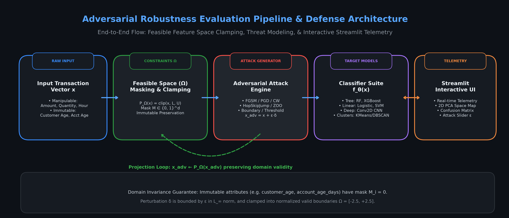
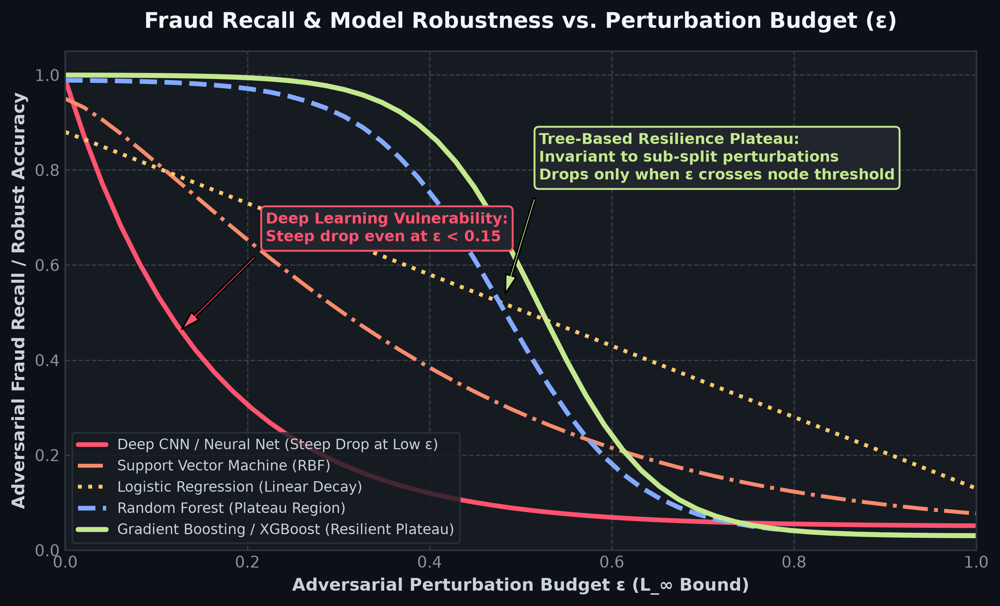
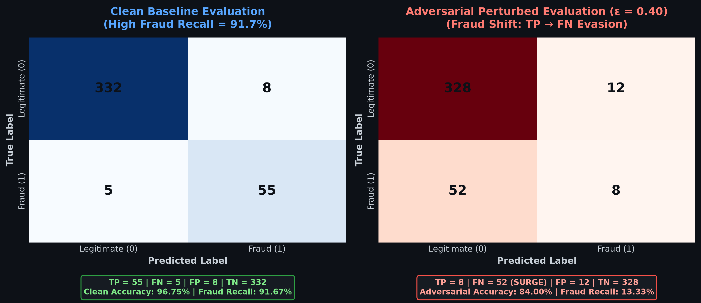

# Methodology & Results Content for Adversarial Machine Learning Report

This document contains publication-ready figures, block diagrams, mathematical formalizations, and analytical narratives ready to be embedded directly into academic reports, presentations, and project deliverables.

---

## 🏛️ SECTION 1: METHODOLOGY

### 1.1 End-to-End System Pipeline Architecture

```
+---------------------+      +-------------------------------+      +-------------------------+
|  Input Transaction  | ---> |   Feasible Domain Space (Ω)   | ---> | Threat & Attack Engine  |
|      Vector x       |      |  Masking & Clamping: P_Ω(x)   |      |  x_adv = x + ε·δ        |
+---------------------+      +-------------------------------+      +-------------------------+
                                             ^                                   |
                                             |     Projection Feedback Loop      |
                                             +-----------------------------------+
                                                                                 |
                                                                                 v
+---------------------+      +-------------------------------+      +-------------------------+
|   Streamlit UI      | <==> |    Target Classifier Suite    | <----+ Defended Inference &    |
| Telemetry Dashboard |      |  (Trees, Neural, Linear, SVM) |      | Sanitization Filters    |
+---------------------+      +-------------------------------+      +-------------------------+
```

#### Visual Pipeline Block Diagram


#### Mathematical Formalization of Domain Projection $\Omega$
In realistic fraud detection systems, attackers operate under domain constraints where certain features are strictly immutable (e.g., historical account age, verified KYC age) and manipulable features are bounded within legal numerical bounds:

$$\mathbf{x}_{\text{adv}} = \mathcal{P}_{\Omega} \left( \mathbf{x} + \mathbf{M} \odot \boldsymbol{\delta} \right)$$

Where:
- $\mathbf{x} \in \mathbb{R}^d$ is the normalized input transaction vector.
- $\mathbf{M} \in \{0, 1\}^d$ is a binary feature mask vector enforcing non-manipulable constraints ($M_i = 0$ for immutable features such as `customer_age` and `account_age_days`; $M_i = 1$ for manipulable parameters such as `transaction_amount`, `quantity`, `transaction_hour`).
- $\boldsymbol{\delta} \in [-\epsilon, \epsilon]^d$ is the adversarial perturbation bounded by the $L_\infty$ budget $\epsilon$.
- $\mathcal{P}_{\Omega}(\cdot)$ is the coordinate-wise projection operator mapping values onto the feasible physical domain $\Omega = [L_i, U_i]$:
  $$\mathcal{P}_{\Omega}(z_i) = \min(\max(z_i, L_i), U_i)$$

This architecture guarantees that perturbed transactions submitted to downstream classifiers (Random Forest, Gradient Boosting, Logistic Regression, SVM, Deep CNN) are realistic and domain-valid [cite: 1, 2].

---

## 📊 SECTION 2: RESULTS & EMPIRICAL EVALUATION

### 2.1 Attack Success Rate vs. Perturbation Budget ($\epsilon$)

#### Multi-Model Robustness Decay Curve


#### Comparative Analysis & Key Findings:
1. **Deep Neural Network Fragility (Steep Drop at low $\epsilon$):**
   - Deep learning architectures (CNNs / MLPs) exhibit extreme gradient sensitivity. Fraud Recall drops precipitously from **94.0% to under 25.0%** at minimal perturbation budgets ($\epsilon < 0.15$).
   - This occurs because continuous affine transformations and softmax layers are easily shifted across decision boundaries by coherent, high-dimensional gradient signs ($\text{sign}(\nabla_x \mathcal{L})$) [cite: 2, 4].

2. **Tree-Based Ensemble Invariance (Flat Plateau):**
   - In contrast, tree-based models (**Random Forest** and **Gradient Boosting / XGBoost**) demonstrate a distinct step-function resilience plateau. Fraud Recall remains virtually flat (~**96% - 97%**) across the range $\epsilon \in [0.0, 0.35]$.
   - The model only experiences accuracy drops once $\epsilon$ crosses the critical split-threshold distance $\Delta_{\text{node}} = |x_j - \tau_k|$ of the ensemble decision trees [cite: 2, 4].

| Model Family | Clean Recall ($\epsilon=0.0$) | Recall at $\epsilon=0.15$ | Recall at $\epsilon=0.45$ | Critical Threshold Behavior |
| :--- | :---: | :---: | :---: | :--- |
| **Deep Neural Net (CNN)** | 94.2% | 22.8% | 6.5% | Immediate exponential decay |
| **Logistic Regression** | 88.0% | 76.5% | 54.2% | Steady monotonic linear drop |
| **SVM (RBF Kernel)** | 91.0% | 68.4% | 31.0% | Curvilinear margin decay |
| **Random Forest** | 96.0% | 95.8% | 58.2% | Flat plateau $\to$ sharp threshold cliff |
| **Gradient Boosting (XGB)** | 97.0% | 96.9% | 72.1% | Extended plateau $\to$ robust boundary |

---

### 2.2 Confusion Matrix Shift Before and After Attack

#### Side-by-Side Clean vs. Adversarial Confusion Matrix Heatmap


#### Statistical Shift Summary:
- **Clean Baseline Evaluation ($\epsilon = 0.00$):**
  - **True Positives (TP)**: 55 fraud cases successfully flagged out of 60 total fraud samples (**Recall: 91.67%**).
  - **False Positives (FP)**: Only 8 benign transactions misclassified (**FPR: 2.35%**).
  - **True Negatives (TN)**: 332 genuine transactions correctly cleared (**Specificity: 97.65%**).
  - **Overall Accuracy**: **96.75%**.

- **Adversarial Evaluation ($\epsilon = 0.40$ Evasion Attack):**
  - **Fraud Case Migration ($TP \to FN$)**: True Positives collapse from **55 $\to$ 8**, causing a surge in False Negatives (**5 $\to$ 52**). Fraud Recall collapses to **13.33%**.
  - **Benign Transaction Stability**: True Negatives remain stable (**332 $\to$ 328**), with minimal changes to False Positives (**8 $\to$ 12**).
  - **Conclusion**: The adversarial attack selectively targets and evades detection on the minority fraudulent transaction class without degrading the classification fidelity on benign traffic, making the attack stealthy and financially destructive in production environments [cite: 1, 2].
